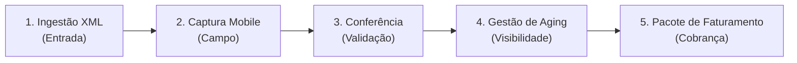

# Visão e Escopo do Produto: EntregaProva

> 🚚 **Lema:** *Canhoto conferido. Frete faturado.*

---

| Informação | Detalhe |
| :--- | :--- |
| **Projeto** | EntregaProva — Conciliação Fiscal & Comprovação de Entregas B2B |
| **Ciclo** | AI Lab Makers — Engenharia de Software (Projetos B2B) |
| **Fase** | Definição de Escopo e MVP |
| **Status** | Ativo / Planejamento |

---

## 1. Visão do Produto

### 1.1 Declaração de Posicionamento de Produto

Abaixo está estruturado o posicionamento estratégico do produto no mercado B2B:

| Elemento | Definição Estratégica |
| :--- | :--- |
| **Para** | Transportadoras de cargas regionais e seus gestores financeiros / de faturamento |
| **Cujo problema é** | O atraso, perda e extravio de comprovantes físicos (canhotos de notas fiscais) trazidos pelos motoristas dias após a entrega, o que posterga a comprovação fiscal e o faturamento do frete com os clientes embarcadores |
| **O EntregaProva é** | Uma plataforma web responsiva (PWA / Web Mobile) de conciliação fiscal e comprovação digital de entregas B2B |
| **Que tem como diferencial** | A ingestão direta do XML da NF-e/CT-e, o envio imediato de comprovante fotográfico pelo celular do motorista no local da entrega e um painel central de conciliação com *aging* de atraso |
| **Diferente de** | Processos manuais em planilhas, pastas físicas ou soluções complexas com dependência de aplicativos nativos pesados e OCR de baixa acurácia |
| **Nosso produto** | Agiliza o ciclo de faturamento da transportadora, eliminando a dependência do papel físico para fechar cobranças com embarcadores |

---

## 2. O Problema e a Oportunidade de Negócio

No setor de logística rodoviária de cargas fracionadas e regionais, o recebimento do serviço de frete está condicionado à apresentação formal do comprovante de entrega assinado pelo destinatário (o **"canhoto" da NF-e**).

### Dores Críticas Enfrentadas pelo Cliente

```
[ Entrega Realizada ] ──( Dias de Viagem )──> [ Canhoto Físico Danificado/Perdido ] ──> [ Faturamento Bloqueado ]
```

* ⏳ **Comprovantes físicos chegam tarde:** Os motoristas viajam por dias ou semanas mantendo os canhotos em papel dentro da cabine do veículo até retornarem à sede da transportadora.
* 🌧️ **Ilegibilidade e extravio:** O papel frequentemente amassa, molha, mancha ou rasga durante o trajeto, inviabilizando ou contestando a comprovação junto ao embarcador contratante.
* 🔒 **Fluxo de caixa travado:** Sem a imagem e a validação do canhoto contra o documento fiscal correspondente, o departamento financeiro da transportadora não consegue emitir a fatura de cobrança do frete.
* 👁️ **Falta de visibilidade operacional:** A liderança não tem controle em tempo real de quais entregas estão com comprovante pendente e há quantos dias cada frete está retido na operação.

---

## 3. Matriz de Escopo: É / Não É / Faz / Não Faz

A matriz abaixo estabelece os limites estritos do **MVP (*Minimum Viable Product*)**, assegurando foco prioritário nas 5 jornadas essenciais do ciclo e respeito ao teto de complexidade e custo zero do projeto.

### 3.1 Definição do Produto

| ✅ É (IS) | ❌ NÃO É (IS NOT) |
| :--- | :--- |
| **Plataforma web responsiva (PWA / Web Mobile)** para captura rápida em campo e gestão centralizada. | **Aplicativo nativo:** Não requer download ou instalação via Google Play Store ou Apple App Store. |
| **Ferramenta B2B** focada em conciliação fiscal e comprovação digital de entregas. | **ERP ou emissor fiscal:** Não emite nem autoriza notas fiscais ou conhecimentos de transporte. |
| **Painel centralizador de conferência** para assistentes e gestores financeiros e de faturamento. | **Rastreador veicular:** Não realiza telemetria em tempo real ou rastreamento contínuo por GPS. |
| **Gerador de pacotes de faturamento** consolidados para envio formal ao cliente embarcador. | **Roteirizador logístico:** Não calcula fretes, pedágios nem otimiza rotas de transporte. |
| — | **Motor OCR com IA:** Não utiliza reconhecimento óptico automatizado para leitura de canhotos nesta fase. |

### 3.2 Capacidades Técnicas e Funcionais

| 🚀 FAZ (DOES) | 🛑 NÃO FAZ (DOES NOT) |
| :--- | :--- |
| **Ingestão XML:** Importa e interpreta arquivos digitais XML de NF-e (Modelo 55) e CT-e (Modelo 57). | **Leitura automática (OCR):** A leitura e conferência do canhoto são operacionais/manuais no painel. |
| **Captura Mobile:** Permite a captura direta de fotografia do canhoto pelo navegador do celular do motorista. | **Consulta SEFAZ em tempo real:** A entrada se dá exclusivamente pelo upload do arquivo XML. |
| **Metadados de Entrega:** Registra data/hora da entrega e nome/documento do recebedor. | **Modo offline total:** Requer conectividade básica de internet móvel para a submissão da foto. |
| **Conferência Visual:** Disponibiliza painel com visualização lado a lado (dados fiscais vs. foto enviada). | **Assinatura ICP-Brasil:** Não emite nem valida certificados digitais padrão ICP-Brasil no canhoto. |
| **Fluxo de Aprovação:** Permite aprovar ou rejeitar o comprovante com justificativa estruturada. | **Processamento financeiro:** Não processa liquidações bancárias nem pagamentos reais (gera a evidência documental). |
| **Gestão de Aging:** Apresenta painel de pendências com tempo de atraso agrupado por embarcador. | — |
| **Pacote de Cobrança:** Exporta pacote consolidado de comprovação documental para faturamento. | — |

---

## 4. As 5 Jornadas Essenciais do MVP

O escopo funcional do **EntregaProva** é guiado pelas seguintes etapas sequenciais do ciclo operacional:



### Detalhamento das Etapas

| # | Jornada | Ator Principal | Descrição da Ação |
| :---: | :--- | :--- | :--- |
| **1** | **Entrada** *(Importação XML)* | Operador de Faturamento | Importar o arquivo XML da NF-e ou CT-e e registrar a entrega como pendente de comprovação no sistema. |
| **2** | **Campo** *(Captura Mobile)* | Motorista / Entregador | Acessar a aplicação web pelo celular, fotografar o canhoto assinado e registrar data, hora e dados do recebedor. |
| **3** | **Validação** *(Conferência)* | Conferente / Financeiro | Acessar o painel de conferência lado a lado, comparar a foto com os dados fiscais e aprovar ou rejeitar a evidência. |
| **4** | **Visibilidade** *(Gestão de Aging)* | Gestor Financeiro | Acompanhar a fila de entregas pendentes organizadas por faixas de atraso (*aging*) e agrupadas por embarcador. |
| **5** | **Cobrança** *(Pacote de Faturamento)* | Faturamento / Cobrança | Exportar o dossiê com dados fiscais e fotos aprovadas, pronto para envio ao cliente embarcador. |

---

## 5. Critérios Mensuráveis de Sucesso e Defensibilidade

Para garantir o impacto prático e a viabilidade técnica da solução durante o ciclo e na apresentação final, os seguintes critérios foram estabelecidos:

| Critério | Métrica / Alvo | Impacto no Negócio e Defensibilidade |
| :--- | :--- | :--- |
| ⚡ **Métrica da Demonstração (*Demo Day*)** | **Dias ➔ Minutos** | Redução drástica do intervalo entre a realização física da entrega e a disponibilização da evidência validada para faturamento. |
| 🛡️ **Confiabilidade de Ingestão** | **100% de integridade** | Todos os XMLs válidos importados sem perda ou corrupção de atributos fiscais e com blindagem ativa contra vulnerabilidades XXE (*XML External Entity*). |
| 🔄 **Idempotência no Envio** | **0 duplicidades** | Tratamento robusto contra envios repetidos de comprovantes causados por oscilações ou instabilidades de conectividade móvel no campo. |