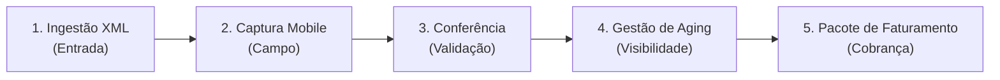

# Visão e Escopo do Produto: EntregaProva

> :material-truck-delivery: **Lema:** *Canhoto conferido. Frete faturado.*

| Informação | Detalhe |
| :--- | :--- |
| **Projeto** | EntregaProva — Conciliação Fiscal & Comprovação de Entregas B2B |
| **Ciclo** | AI Lab Makers — Engenharia de Software (Projetos B2B) |
| **Fase** | Definição de Escopo e MVP |
| **Status** | Ativo / Planejamento |

## 1. Visão do Produto

### 1.1 Declaração de posicionamento

Abaixo está o posicionamento estratégico do produto no mercado B2B:

| Elemento | Definição estratégica |
| :--- | :--- |
| **Para** | Transportadoras de cargas regionais e seus gestores financeiros / de faturamento |
| **Cujo problema é** | O atraso, perda e extravio de comprovantes físicos (canhotos de notas fiscais) trazidos pelos motoristas dias após a entrega, o que posterga a comprovação fiscal e o faturamento do frete com os clientes embarcadores |
| **O EntregaProva é** | Uma plataforma web responsiva (PWA / Web Mobile) de conciliação fiscal e comprovação digital de entregas B2B |
| **Que tem como diferencial** | A ingestão direta do XML da NF-e/CT-e, o envio imediato de comprovante fotográfico pelo celular do motorista no local da entrega e um painel central de conciliação com *aging* de atraso |
| **Diferente de** | Processos manuais em planilhas, pastas físicas ou soluções complexas com dependência de aplicativos nativos pesados e OCR de baixa acurácia |
| **Nosso produto** | Agiliza o ciclo de faturamento da transportadora, eliminando a dependência do papel físico para fechar cobranças com embarcadores |

## 2. O problema e a oportunidade de negócio

No setor de logística rodoviária de cargas fracionadas e regionais, o recebimento do frete depende da apresentação formal do comprovante de entrega assinado pelo destinatário (o **"canhoto" da NF-e**).

### Dores críticas do cliente

```
[ Entrega realizada ] ──( dias de viagem )──> [ Canhoto físico danificado/perdido ] ──> [ Faturamento bloqueado ]
```

* :material-timer-sand: **Comprovantes físicos chegam tarde:** os motoristas viajam por dias ou semanas com os canhotos em papel na cabine até retornarem à sede da transportadora.
* :material-weather-pouring: **Ilegibilidade e extravio:** o papel amassa, molha, mancha ou rasga durante o trajeto, o que inviabiliza ou contesta a comprovação junto ao embarcador contratante.
* :material-lock-outline: **Fluxo de caixa travado:** sem a imagem e a validação do canhoto contra o documento fiscal, o financeiro da transportadora não consegue emitir a fatura do frete.
* :material-eye-off-outline: **Falta de visibilidade operacional:** a liderança não vê em tempo real quais entregas estão com comprovante pendente nem há quantos dias cada frete está retido.

## 3. Matriz de escopo: é / não é / faz / não faz

A matriz abaixo define os limites do **MVP (*Minimum Viable Product*)**. Ela garante foco nas 5 jornadas essenciais do ciclo e respeita o teto de complexidade e o custo zero do projeto.

### 3.1 Definição do produto

| :material-check-circle: É | :material-close-circle: NÃO É |
| :--- | :--- |
| **Plataforma web responsiva (PWA / Web Mobile)** para captura rápida em campo e gestão centralizada. | **Aplicativo nativo:** não requer download ou instalação via Google Play Store ou Apple App Store. |
| **Ferramenta B2B** focada em conciliação fiscal e comprovação digital de entregas. | **ERP ou emissor fiscal:** não emite nem autoriza notas fiscais ou conhecimentos de transporte. |
| **Painel centralizador de conferência** para assistentes e gestores financeiros e de faturamento. | **Rastreador veicular:** não realiza telemetria em tempo real ou rastreamento contínuo por GPS. |
| **Gerador de pacotes de faturamento** consolidados para envio formal ao cliente embarcador. | **Roteirizador logístico:** não calcula fretes, pedágios nem otimiza rotas de transporte. |
| Não se aplica. | **Motor OCR com IA:** não utiliza reconhecimento óptico automatizado para leitura de canhotos nesta fase. |

### 3.2 Capacidades técnicas e funcionais

| :material-rocket-launch: FAZ | :material-hand-back-right-off: NÃO FAZ |
| :--- | :--- |
| **Ingestão XML:** importa e interpreta arquivos XML de NF-e (Modelo 55) e CT-e (Modelo 57). | **Leitura automática (OCR):** a leitura e conferência do canhoto são operacionais/manuais no painel. |
| **Captura mobile:** permite a captura direta de fotografia do canhoto pelo navegador do celular do motorista. | **Consulta SEFAZ em tempo real:** a entrada se dá exclusivamente pelo upload do arquivo XML. |
| **Metadados de entrega:** registra data/hora da entrega e nome do recebedor. | **Modo offline total:** requer conectividade básica de internet móvel para a submissão da foto. |
| **Conferência visual:** disponibiliza painel com visualização lado a lado (dados fiscais vs. foto enviada). | **Assinatura ICP-Brasil:** não emite nem valida certificados digitais padrão ICP-Brasil no canhoto. |
| **Fluxo de aprovação:** permite aprovar ou rejeitar o comprovante com justificativa estruturada. | **Processamento financeiro:** não processa liquidações bancárias nem pagamentos reais (gera a evidência documental). |
| **Gestão de aging:** apresenta painel de pendências com tempo de atraso agrupado por embarcador. | Não se aplica. |
| **Pacote de cobrança:** exporta pacote consolidado de comprovação documental para faturamento. | Não se aplica. |

## 4. As 5 jornadas essenciais do MVP

O escopo funcional do **EntregaProva** segue estas etapas sequenciais do ciclo operacional:



### Detalhamento das etapas

| # | Jornada | Ator principal | Descrição da ação |
| :---: | :--- | :--- | :--- |
| **1** | **Entrada** *(importação XML)* | Operador de faturamento | Importar o arquivo XML da NF-e ou CT-e e registrar a entrega como pendente de comprovação no sistema. |
| **2** | **Campo** *(captura mobile)* | Motorista / entregador | Acessar a aplicação web pelo celular, fotografar o canhoto assinado e registrar data, hora e dados do recebedor. |
| **3** | **Validação** *(conferência)* | Conferente / financeiro | Acessar o painel de conferência lado a lado, comparar a foto com os dados fiscais e aprovar ou rejeitar a evidência. |
| **4** | **Visibilidade** *(gestão de aging)* | Gestor financeiro | Acompanhar a fila de entregas pendentes por faixas de atraso (*aging*) e agrupadas por embarcador. |
| **5** | **Cobrança** *(pacote de faturamento)* | Faturamento / cobrança | Exportar o dossiê com dados fiscais e fotos aprovadas, pronto para envio ao cliente embarcador. |

## 5. Critérios mensuráveis de sucesso e defensibilidade

Para garantir o impacto prático e a viabilidade técnica durante o ciclo e na apresentação final, foram estabelecidos os critérios abaixo:

| Critério | Métrica / alvo | Impacto no negócio e defensibilidade |
| :--- | :--- | :--- |
| :material-lightning-bolt: **Métrica da demonstração (*Demo Day*)** | **Dias ➔ minutos** | Redução drástica do intervalo entre a entrega física e a disponibilização da evidência validada para faturamento. |
| :material-shield-check: **Confiabilidade de ingestão** | **100% de integridade** | Todos os XMLs válidos são importados sem perda ou corrupção de atributos fiscais, com proteção ativa contra vulnerabilidades XXE (*XML External Entity*). |
| :material-sync: **Idempotência no envio** | **0 duplicidades** | Tratamento robusto contra envios repetidos de comprovantes causados por oscilações de conectividade móvel no campo. |
